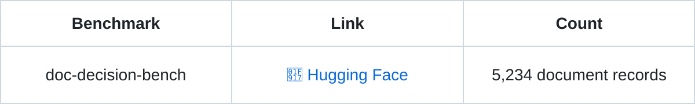
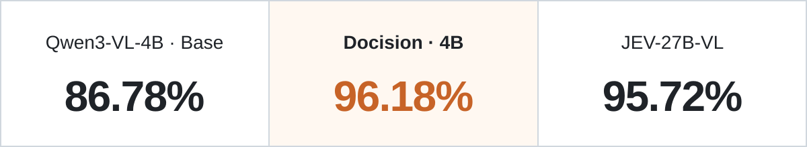

<p align="center">
  
</p>

<h1 align="center"></h1>
<p align="center"><b>Jev-Inspired Multimodal Decisions for Documents.</b></p>
<p align="center"><b>English</b> &nbsp;  &nbsp; <a href="README.zh-CN.md">简体中文</a></p>
<p align="center">
  <a href="https://huggingface.co/SoMarkAI/Docision-1.0"></a>
  <a href="https://huggingface.co/datasets/SoMarkAI/doc-decision-bench"></a>
</p>

## 👀 Decision intelligence beyond text

**One document can answer multiple decision questions.** Given the same invoice, a finance team asks whether it is eligible for reimbursement, an archive system asks how to classify it, and a reviewer checks whether signatures and seals are present. There is one document, but more than one decision.

Docision brings candidate-answer decisions to multimodal documents: from document classification and visual attribute recognition to understanding content relationships, applying business rules, and even analyzing engineering drawings and scientific charts.
Docision unifies document tasks through one simple interaction: Your Document. Your Question. Your Decision.

**Docision focuses on document understanding and decisions.** Identify document categories, check relationships between fields, verify completeness, and make decisions or route documents under the rules you provide.

- **⚡ Keep the context**: multiple questions about the same image benefit from a multiplicative speedup.
- **🧩 Bring your choices**: define candidates independently for each question; both their content and count can vary.
- **🔎 Inspect each decision**: receive the model's choice and the probability of each candidate.

> If this project helps you, please give it a ⭐ Star in the top right—it is the greatest encouragement for the developers!

<a id="benchmark"></a>

## 🎯 Document decisions beyond a 27B model—higher speed, higher accuracy.

<p align="center">
  <a href="https://huggingface.co/datasets/SoMarkAI/doc-decision-bench"><picture>
    <source media="(prefers-color-scheme: dark)" srcset="assets/benchmark-table.en.dark.svg">
    <source media="(prefers-color-scheme: light)" srcset="assets/benchmark-table.en.svg">
    
  </picture></a>
</p>

Covers **document understanding and decisions, and cross-industry classification**, with higher speed and quality.

<p align="center">
  
</p>


---

## 🤗 Find our model here

<p align="center">
  <a href="https://huggingface.co/SoMarkAI/Docision-1.0"><picture>
    <source media="(prefers-color-scheme: dark)" srcset="assets/model-table.en.dark.svg">
    <source media="(prefers-color-scheme: light)" srcset="assets/model-table.en.svg">
    
  </picture></a>
</p>

<a id="start"></a>

## 🚀 Installation and inference

```bash
git clone https://github.com/SoMarkAI/docision.git
cd docision
python3 -m venv .venv
source .venv/bin/activate
python -m pip install -e '.' huggingface_hub
hf download SoMarkAI/Docision-1.0 --local-dir models/Docision-1.0

CUDA_VISIBLE_DEVICES=0 python demo_docision.py \
  --model models/Docision-1.0 \
  --input examples/multiple.json \
  --output outputs/document-decisions.json
```

Results are saved to `outputs/document-decisions.json`. Replace the input file to try your own documents.


---

## 📥 Input and output

One JSON file describes a document image and its questions. The `image` path is resolved relative to the JSON file; each question defines its own question text and candidates:

```json
{
  "image": "page.png",
  "questions": [
    {
      "id": "q1",
      "question": "Which category does this document belong to?",
      "candidates": {"A": "Invoice", "B": "Receipt", "C": "Contract"}
    }
  ]
}
```

Results preserve question order, including each candidate's `probability` and the final choice in `decision`.

Candidates contain only `label`, `text` and `probability`; `decision` reports the selected candidate, its index and tie-handling information.


## 🔌 MCP integration

Connect Docision to Codex or Claude Code to inspect local documents, ask multiple questions, and export JSON or CSV results.

Install MCP dependencies from the repository:

```bash
python -m pip install '.[mcp]'
```

Configure your MCP client to launch this stdio bridge:

```bash
docision mcp --api-url http://127.0.0.1:7860 \
  --token-file /absolute/path/to/api-token \
  --allowed-root /absolute/path/to/documents \
  --output-dir /absolute/path/to/exports
```

The bridge connects to a running Docision model service. Document and export paths belong to the MCP host; the model runs on the service host. See the [MCP setup instructions](docs/python-package.md#mcp) for prerequisites and remote GPU connections.

<p align="center">This project is licensed under the <a href="LICENSE">Apache License 2.0</a>.</p>
