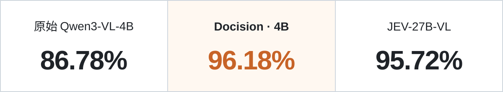

<p align="center">
  
</p>

<h1 align="center"></h1>
<p align="center"><b>Jev-Inspired Multimodal Decisions for Documents.</b></p>
<p align="center"><a href="README.md">English</a> &nbsp;  &nbsp; <b>简体中文</b></p>
<p align="center">
  <a href="https://huggingface.co/SoMarkAI/Docision-1.0"></a>
  <a href="https://huggingface.co/datasets/SoMarkAI/doc-decision-bench"></a>
</p>

## 👀 超越文本的决策智能

**同一份文档，可以回答多个决策问题。** 同一张发票，财务关心能否报销，档案系统关心如何归类，审核人员关心签章是否完整。文档只有一份，决策却不止一种。

Docision 将候选答案决策用于多模态文档。 从文档分类、视觉属性识别，到内容关系理解、业务规则判断，甚至工程图纸与科研图表分析。
Docision 将不同的文档任务统一为一种简单的交互方式：Your Document. Your Question. Your Decision.

**Docision 专注文档理解与决策。** 识别文档类别、核对字段关系、检查材料是否齐全，再依据你给定的规则，完成判断与分流。

- **⚡ 上下文接着用**：如果你对同一张图有多个问题，将获得成倍的速度加持。
- **🧩 选项由你定**：每道题独立设置候选项，内容和数量都可不同。
- **🔎 决策看得见**：同时返回模型选择、各候选项的概率。


> 如果这个项目对你有帮助，请点击右上角的 ⭐ Star——这是对开发者最大的鼓励！

<a id="benchmark"></a>

## 🎯 文档决策，超越27B模型--更快的速度，更高的准确率。

<div align="center">

<table width="100%" align="center" border="1" cellspacing="0" cellpadding="8" style="width: 100%; border-collapse: collapse; border: 1px solid #888;">
  <thead><tr><th width="33%" style="border: 1px solid #888; text-align: center;" align="center">Benchmark</th><th width="33%" style="border: 1px solid #888; text-align: center;" align="center">链接</th><th width="34%" style="border: 1px solid #888; text-align: center;" align="center">数量</th></tr></thead>
  <tbody><tr><td style="border: 1px solid #888; text-align: center;" align="center">doc-decision-bench</td><td style="border: 1px solid #888; text-align: center;" align="center">🤗 <a href="https://huggingface.co/datasets/SoMarkAI/doc-decision-bench">Hugging Face</a></td><td style="border: 1px solid #888; text-align: center;" align="center">5,234条文档数据</td></tr></tbody>
</table>

</div>

覆盖**文档理解与决策、跨行业分类**，更快的速度，更高的质量。

<p align="center">
  
</p>


---

## 🤗模型在这里

<div align="center">

<table width="100%" align="center" border="1" cellspacing="0" cellpadding="8" style="width: 100%; border-collapse: collapse; border: 1px solid #888;">
  <thead><tr><th width="50%" style="border: 1px solid #888; text-align: center;" align="center">试试我们的模型</th><th width="50%" style="border: 1px solid #888; text-align: center;" align="center">链接</th></tr></thead>
  <tbody><tr><td style="border: 1px solid #888; text-align: center;" align="center">Docision-1.0</td><td style="border: 1px solid #888; text-align: center;" align="center">🤗 <a href="https://huggingface.co/SoMarkAI/Docision-1.0">Hugging Face</a></td></tr></tbody>
</table>

</div>

<a id="start"></a>

## 🚀 安装与运行
```bash
git clone https://github.com/SoMarkAI/docision.git
cd docision
python3 -m venv .venv
source .venv/bin/activate
python -m pip install -e '.' huggingface_hub
hf download SoMarkAI/Docision-1.0 --local-dir models/Docision-1.0

CUDA_VISIBLE_DEVICES=0 python demo_docision.py \
  --model models/Docision-1.0 \
  --input examples/multiple.json \
  --output outputs/document-decisions.json
```

结果保存在 `outputs/document-decisions.json`。替换输入文件，即可尝试自己的文档。


---

## 📥 输入与输出

一个 JSON 文件描述一张文档图片及其问题。`image` 路径相对于 JSON 文件解析；每道题单独定义问题和候选项：

```json
{
  "image": "page.png",
  "questions": [
    {
      "id": "q1",
      "question": "这份文档属于哪一类？",
      "candidates": {"A": "发票", "B": "收据", "C": "合同"}
    }
  ]
}
```

结果按问题顺序返回，包括各选项的 `probability`，以及 `decision` 中的最终选择。

候选项仅包含 `label`、`text` 和 `probability`；`decision` 返回最终选择及其索引和并列处理信息。


## 🔌 MCP 接入

将 Docision 接入 Codex 或 Claude Code，即可检查本地文档、一次提出多个问题，并导出 JSON 或 CSV 结果。

在仓库内安装 MCP 依赖：

```bash
python -m pip install '.[mcp]'
```

在 MCP 客户端中配置以下 stdio 桥接启动命令：

```bash
docision mcp --api-url http://127.0.0.1:7860 \
  --token-file /absolute/path/to/api-token \
  --allowed-root /absolute/path/to/documents \
  --output-dir /absolute/path/to/exports
```

桥接连接已启动的 Docision 模型服务。文档和导出路径位于 MCP 主机，模型运行在服务主机上。前置配置与远端 GPU 连接方式见 [MCP 接入说明](docs/python-package.zh-CN.md#mcp)。

<p align="center"><a href="LICENSE">Apache-2.0</a> — 基于 Apache 2.0 的自定义许可证。</p>
