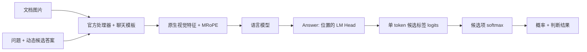

# 架构

[项目首页](../README.zh-CN.md)

## 有限的决策空间

A、B、C… 等标签在完整渲染的 `Answer:\n` 前缀之后编码。构建器会检查：追加每个标签时，必须恰好增加一个互不相同的 token，并且不改变已有前缀。候选项的 token 区间会在官方图片 token 展开过程中持续跟踪。

模型执行一次前向传播。只有最后一个位置通过未经修改的 LM Head 进行投影，随后提取各标签的 logits。这里没有生成式补全文本、答案解析器、另行训练的决策头或全词表采样。公共 API 始终使用 `projection='full'`，以保留训练时输出读取方式的数值行为。

## 注意力

默认使用 **Causal（因果注意力）**。每个位置可以看到前面的 token。靠后的候选项可以看到靠前的候选项；最终答案位置可以看到所有候选项。

**Isolated（隔离注意力）** 会进一步阻止不同候选项之间相互可见。每个候选项可以看到公共上下文、问题，以及自身前面的 token。答案后缀可以看到所有候选项。注意力掩码在原生 MRoPE 构建之后插入，并在评分调用结束后移除，发生异常时也会移除。选择此模式不会改变模型权重。

隔离模式是一种受控推理实验，不保证提高准确率。首次 Docision 训练研究始终使用因果注意力。

## 多问题与缓存

依赖具体问题的 token 永远不会进入可复用的前缀。官方图片处理与公共上下文只预先计算一次；每个问题获得独立克隆的 KV 分支。真正的批量推理会把多个独立问题合并到一次模型前向传播中。右侧填充会被掩码屏蔽，评分读取最后一个真实位置，并保留每个问题原生的位置编码。

分支复制可以避免问题之间相互污染，但也会复制缓存存储；它不是零拷贝 Tree-KV，也不是服务端全局缓存。HF 后端会围绕模型 hook 和数值状态串行化访问。批量大小指一次前向传播中的问题数量，不是独立 HTTP 请求或 Python 工作线程的数量。

## 数值模式

- `native`：BF16 参数与原生 SDPA，对齐首次训练和评测研究。默认批量大小为 1，不使用前缀缓存。
- `stable`：FP32 文本计算与对齐后的注意力，用于比较批量和缓存路径。模型权重文件保持不变；临时计算设置只在限定作用域内生效，之后恢复。

stable 结果可能与原生 BF16 不同。不要把启用缓存的 stable 输出与未启用缓存的 native 结果当作同一种执行协议比较。CLI 的缓存和批量路径要求使用 stable 数值模式。

## 代码位置

| 位置 | 职责 |
| :--- | :--- |
| `docision/engine.py` | 仅面向文档的 API、与训练兼容的 RGB 处理及输入限制 |
| `docision/io.py` | 公共文档 JSON 格式与本地媒体路径解析 |
| `docision/metrics.py` | 准确率、评分校验、语义一致性 |
| `docision/evaluate.py` | 不携带参考标签的模型请求、候选项排列与报告 |
| `docision/_runtime/` | 共享的原生 HF 运行时、处理器、注意力和缓存 |

处理器的默认像素限制为 3,136–501,760。处理后的完整输入最多 4,000 个 token，不会静默截断。
